# Aymeric Weinbach · ZeCloud

Architecture et développement **Cloud & IA**.

Je partage du code, des expérimentations et des conférences autour du cloud,
de l’intelligence artificielle et de la robotique.

[Le blog](https://www.zecloud.fr/) · [Mes dépôts](https://github.com/zecloud?tab=repositories)

## Une contribution, une case à croquer

<picture>
  <source media="(prefers-reduced-motion: reduce)" srcset="./assets/contributions-static.svg">
  
</picture>

[Voir la grille sans animation](./assets/contributions-static.svg)

Le calendrier ci-dessus est un **instantané public**, pas un compteur en temps réel.
L’animation est un aperçu décoratif ; le jeu se joue séparément au clavier ou
avec des boutons de direction, avec un mode sans chrono.

**Jeu interactif : publication en attente.**
[Adresse prévue du jeu Snake](https://www.zecloud.fr/play/) — ce lien ne sera
disponible qu’après fusion et déploiement des changements du site. Le blog
existant reste conservé.

<!-- Keep the publication status above until /play/ has been verified live. -->

<!--
**zecloud/zecloud** is a ✨ _special_ ✨ repository because its `README.md` (this file) appears on your GitHub profile.

Here are some ideas to get you started:

- 🔭 I’m currently working on ...
- 🌱 I’m currently learning ...
- 👯 I’m looking to collaborate on ...
- 🤔 I’m looking for help with ...
- 💬 Ask me about ...
- 📫 How to reach me: ...
- 😄 Pronouns: ...
- ⚡ Fun fact: ...
-->
