# Aymeric Weinbach · ZeCloud

Architecture et développement **Cloud & IA**.

Je partage du code, des expérimentations et des conférences autour du cloud,
de l’intelligence artificielle et de la robotique.

[Le blog](https://www.zecloud.fr/) · [Mes dépôts](https://github.com/zecloud?tab=repositories)

## Une contribution, une case à croquer

[Voir l’animation Snake](./assets/github-contribution-snake.svg)

Le calendrier ci-dessus est un **instantané public**, pas un compteur en temps réel.
L’animation est un aperçu décoratif ; le jeu se joue séparément au clavier ou
avec des boutons de direction, avec un mode sans chrono.

[🐍 Jouer au Snake](https://www.zecloud.fr/snake/) · [Code du jeu](https://github.com/zecloud/snake)

<!--
**zecloud/zecloud** is a ✨ _special_ ✨ repository because its `README.md` (this file) appears on your GitHub profile.

Here are some ideas to get you started:

- 🔭 I’m currently working on ...
- 🌱 I’m currently learning ...
- 👯 I’m looking to collaborate on ...
- 🤔 I’m looking for help with ...
- 💬 Ask me about ...
- 📫 How to reach me: ...
- 😄 Pronouns: ...
- ⚡ Fun fact: ...
-->
